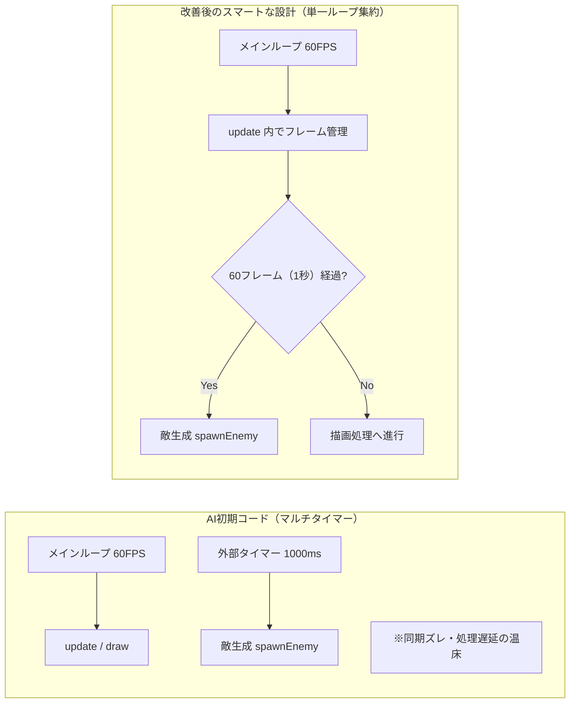
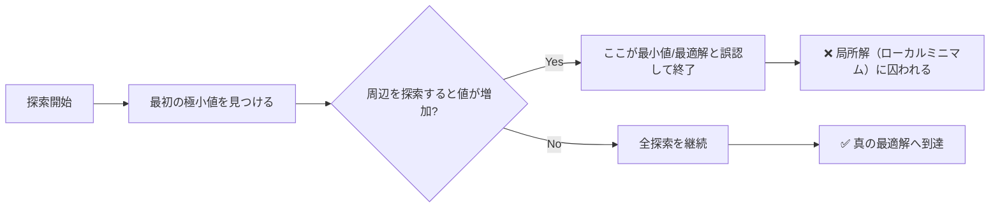

# 🧑‍🏫 AI共創時代におけるロジックの重要性とLLMの限界検証
## 〜プログラム構造分析と数理問題（場合の数）を通じた4大AIベンチマーク調査〜

本ドキュメントは、職業訓練校にて初学者の同期に向けて自発的に開催した勉強会で依頼された講義で用いた資料、および主要AIエージェントの論理的弱点を定量的に検証・分析したナレッジベースです。

AIが秒速でプロトタイプ（動くコードや解答）を出力できる現代だからこそ、人間のエンジニアに求められる「品評眼（ロジックの獲得）」と「例外条件への対応力」の重要性を実証します。

---

## 📊 1. AI生成コードの構造的欠陥を見抜く（勉強会主宰資料より）

AI（Google AIモード等）に作成させた初期のシューティングゲーム（約250行の軽量プロトタイプ）を題材に、コードの裏に潜む「構造の問題点」を炙り出し、実務レベルへリファクタリングするプロセスを共有しました。

### ① マルチタイマーによるメインループの汚染
* **初期コードの欠陥**: 描画（60FPS）を制御するメインループの外部に、敵生成用（1秒周期）の別タイマー（非同期ループ）が並列で動いていた。
* **リスクと不具合**: 処理の衝突や遅延が発生しやすく、ゲームの同期ズレやメモリリークの温床になる。
* **改善策**: メインループ（単一タイマー）内のデータ更新処理（`update()`）の中でフレーム数をカウントし、60フレーム（1秒）経過した瞬間のみ `spawnEnemy()` を呼び出すゲーム設計の標準構造へ集約。

### ② 状態識別フラグ（State）の乱立とスパゲティ化
* **初期コードの欠陥**: `title = true`, `playing = false`, `gameOver = false` など、画面遷移ごとに独立したブーリアンフラグが多数乱立。
* **リスクと不具合**: プログラムの肥大化に伴い、「playing と gameOver が同時に true になる」といった、論理的に起こり得ない不正な状態（バグ）を生む危険性がある（全8ケースの状態フラグ組み合わせ表にて不整合を実証）。
* **改善策**: 状態変位を一元管理する「有限ステートマシン（状態遷移図）」の概念を導入し、厳格なフェーズ制御へと移行。

---

## 🔍 2. 4大AIエージェントによる数理問題ベンチマーク検証

AIが「既知の定型問題」ではなく、「複雑な境界条件」に直面した際の対応力を測定するため、SPI・基本情報技術者試験レベルの「場合の数・組合せ」問題を用いたブラインドテストを実施しました。

### 📋 ベンチマーク結果一覧
（※指示は問題文の直接入力のみ、解説などの前提条件は一切与えない状態での測定）

| 検証問題の概要 | Google AI | Copilot | ChatGPT (4o) | Claude (3.5) | AIの誤答傾向と解説 |
| :--- | :---: | :---: | :---: | :---: | :--- |
| **問107: 4桁の整数の個数（条件付）** | ✕ | ✕ | ✕ | **◯** | AIは場合分けの網羅性が不十分で「420通り」と誤答しがち。 |
| **問108: 6桁・7桁の整数個数の証明** | **◯** | **◯** | **◯** | **◯** | 検算・見直しポイントが構造的に複数ある定型問題には強い。 |
| **問109: 3行3列の整数配置問題** | ✕ | ✕ | **◯** | **◯** | 補角条件や重複排除の網羅性で明確に差が出る。 |
| **問113: 数珠の取り去り問題（境界条件）**| ✕ | ✕ | **◯** | **△** | 複雑な制約に対し、解説の出力途中で自己修正を試みるケースあり。 |
| **問116: n円の一筆書き経路数** | ✕ | ✕ | **◯** | **◯** | 規則性を見出し、一般化（抽象化）する論理構造に差が出る。 |

---

## 📈 3. 数値解析の視点から見る「なぜAIは論理問題で間違えるのか」

大量のデータ（過去ログ）から「確率的に最もそれらしい言葉」を並べるLLM（大規模言語モデル）の仕組みは、数値解析における**「繰り返し計算による近似値の収束」**と完全に同じ構造を持っています。

数値シミュレーション（台風の進路予測など）において、複数の極小値を持つ「多峰性関数」からニュートン・ラフソン法等で最小値を求める際、初期値や探索範囲の与え方が不適切だと、より深い谷があるにもかかわらず手前の谷（局所解：ローカルミニマム）にトラップされ、探索を打ち切ってしまう現象が起きます。

AIが問107などで「420通り」という、もっともらしい誤答を一斉に出力するプロセスは、まさにこの**論理のローカルミニマムへのトラップ現象**そのものです。

### 💡 AIを「思考の壁打ち相手」として乗りこなすための指示技法
曲線が複数の極小値（例外的な場合分け）を持つことが人間の頭で予見できているならば、**「最初からその場合分けのケースを前提として指示（プロンプト）に含める」**、あるいは**「高々数千通りの全探査をコードを書いて実行するように命じる」**という初期値の与え方こそが、AI共創時代におけるエンジニアのロジック構築力です。

---

## 🎯 4. 結論：これからの時代に生き残るエンジニアの定義

今回の検証で明らかな通り、AIは既知の定型問題には完璧に応答しますが、条件に複雑な境界条件が含まれると途端に不具合（疑似解）を吐き出します。AIの出力したコードや解答をそのままコピペして満足するエンジニアは、近い将来確実に淘汰されます。

人間にしかできない本当の仕事とは、
1. AIが出した答えに対して「本当にそうか？」と多面的に疑うこだわり（違和感）を常に持つこと。
2. そのこだわり（経験）を活かして、AIに対して「この例外条件はどう処理する？」と正しいプロンプトを投げ、壁打ちしながら解を真の最適解へと収束させること。

楽をするためにAIという「道具」を使いこなすのは正しいですが、AIの吐き出す擬似解をパケットレベル、数理レベルで判断できる「独自のロジック」と「全探索の視点」を、常に大事にすること。それこそが、人間の知性の輝きです。

---
📄 **本ドキュメントの検証原本および、全問題の解答・解説Excelシートはこちらからダウンロードいただけます。**
* [シューティングゲームを題材にコード分析方法の解説シート (.xlsx)](./supplementary-materials/shooting_game.xlsx)
* [SPI対策：場合の数についての問題と解説シート (.xlsx)](./supplementary-materials/場合の数問題と解答.xlsx.xlsx)

