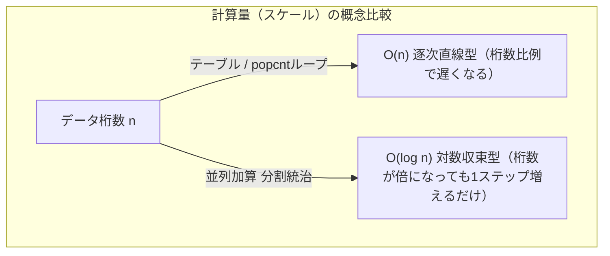

# 🥽 1バイトの処理から数理宇宙へ：ビットカウント・アルゴリズムの探求
## 〜HAKMEMの魔術の解読、\(O(\log N)\)スケール戦略、そして心の位相空間（トポロジー）〜

「Pythonのライブラリを叩けばAIなんてすぐ組める」「モダンなフレームワークさえ知っていればプログラマとして生きていける」もしそんな風に考えているなら、それは危険な勘違いです。

システムの裏側で走っているハードウェアの基本構造（アーキテクチャ）や数理の美しい構造を知らなければ、自動運転のような「絶対にフリーズや遅延が許されない」極限の環境で戦える本物のアーキテクトにはなれません。

本ドキュメントでは、コンピュータが最も得意とする「0と1の処理」の極限である**ビットカウント（立っている「1」の数を数えるアルゴリズム：ハミング重量）**を題材に、人間の遊び心が生み出したエレガントな「別解」の数理を紐解きます。

---

## 📊 1. ビットカウント・6つのアプローチと物理ベンチマーク検証

同一環境（CPU）において、32ビットのデータに対する各アルゴリズムを「1億回」実行した際の物理的な処理時間のログデータです。**最速と最遅で約30倍の処理速度差**が生まれます。

| 関数名 | 処理時間（秒） | 速度比 | 設計思想（アーキテクチャ） | 特徴と使いどころ |
| :--- | :---: | :---: | :--- | :--- |
| **① 力まかせループ** | 9.406 | 1.0倍 | 愚直な全探索（シリアル処理） | マスクを1ビットずつ左シフトして確認。論理が平易で可読性が高い。 |
| **② 空間置換テーブル** | 0.682 | 約13.8倍 | 計算のプリコンパイル（空間置換） | 256個の配列をメモリ展開。空間（容量）に余裕があれば最強。 |
| **③ カーニハン流** | 2.509 | 約3.75倍 | 無駄なゼロのスキップ | `x & (x - 1)` で最下位の1を直接消去。データがスカスカ（疎）な時に効果。 |
| **④ HAKMEMの魔術** | 0.449 | 約21.0倍 | 3ビットごとの8進数和算 | 1970年代のMITハッカー集団の遺産。剰余演算（`% 077`）で一括回収。 |
| **⑤ 並列加算（分割統治）**| 0.450 | 約21.0倍 | 分岐のない並列加算回路の再現 | ビットマスクで2, 4, 8, 16単位で一斉加算。自動運転など遅延厳禁なエッジAI用。 |
| **⑥ popcnt (CPU命令)** | 0.313 | 約30.0倍 | ハードウェア層へのダイレクトコミット | CPUが持つ専用の物理回路を直接叩く。実行環境にあれば大正解。 |

> 💡 **アーキテクトの品評眼**: どれが良い悪いで判断するのではなく、制約条件（環境、速度、可読性のプライオリティ）に応じて、引き出しの中から最適なものを提示できることこそがエンジニアの仕事です。

---

## 🔮 2. AIが全滅した「HAKMEM（方法4）の魔術」の数理解読

今回の資料作成にあたり、主要AI（Google AIモード、Copilot、ChatGPT、Claude）すべてにこの「方法4」のコードを解説させましたが、100点の解答を出せたAIは存在せず、誤答や沈黙を連発しました。過去ログの確率論で動くAIに対し、**人間の知性が数理の美しさを解き明かしたプロセス**をここに記録します。

### 第一段階：3ビットずつの独立したカウント
このアルゴリズムは、3ビットの部屋の中で「立っている1の数」を、ループなしで一斉に数え上げます。
元のビット列を `101` とすると：
1. 1回右シフトしてマスクをかける \(\rightarrow 010\)
2. 元の数から「右シフトした数」と「さらに右シフトしてマスクした数」を引く：
   \[101_2 - 010_2 - 001_2 = 010_2 (\text{10進数の } 2)\]
この引算により、各3ビットの部屋に「その部屋の1の個数」そのものが格納されます。

### 第二段階：8進数剰余（% 077）による一斉回収
一見、なぜこれで合計が出るのか不思議になりますが、これは**10進数における「99の剰余（余り）」と同じ原理**です。
例えば、`123456` という数字を `99` で割るケースを考えます。
\[12 \times (99+1)^2 + 34 \times (99+1) + 56 = 12 \times 99^2 + 34 \times 99 + (12 + 34 + 56)\]
これを `99` で割ると、99が含まれる項はすべて消え去り、余りは各桁を2桁ずつに区切った和 \((12 + 34 + 56)\) に収束します。

HAKMEMのコードは、この性質を**8進数（`077`）の空間で応用**しています。3ビット（および隣を足した6ビット）ごとに散らばったカウント数を、たった1回の剰余演算で一瞬にしてすべて足し合わせるという、人間の遊び心の極致が生んだ「生の芸術（アール・ブリュット）」的な神業です。

---

## 📈 3. 発展課題：データが「1024ビット」に巨大化した際のスケール戦略

「質問が1000問ある超巨大性格診断」や「自動運転AIが扱う1024ビットのパケット」を処理する場合、これまでのアプローチの優位性は完全に逆転します。

* **popcnt / テーブル処理の限界**: 1024ビット（128バイト）を処理するには、いくら物理命令が速くても128回のループが発生し、計算量は **\(O(n)\) の逐次処理**へ退化します。
* **並列加算（分割統治）の真価**: 
  32ビットの空間で5ステップだった処理は、64ビットで6ステップ、1024ビットになっても**たったの10ステップ**で完了します。

データの桁数が32倍（32ビット \(\rightarrow\) 1024ビット）になっても、計算のステップ数はたったの2倍にしかなりません。これこそが、スケールに対して **\(O(\log N)\)** の時間計算量で突き抜ける「⑤並列加算」の設計思想であり、画像認識などのエッジAI認知エンジンで致命的な遅延（タイムアウト）を防ぐための究極の構造設計です。

---

## 🌌 4. デジタルとアナログを繋ぐ「心の位相空間（トポロジー）」

最後に、アーキテクトとしてもう一段高い視座へジャンプしてみましょう。
私たちが100問の相性診断の「はい（1）／いいえ（0）」で人と人との相性を測るとき、使っているのは単なる算数の足し算ではなく、数学における**「位相空間（Topological Space）における『近さ』の概念」**そのものです。

### ① 0と1の羅列から「距離」が生まれる瞬間
人間の複雑で生々しいアナログな内面を、100桁の0と1のビット列に落とし込む。これだけでは、ただのカチカチとした不連続なデジタルデータです。しかし、ここに「ハミング距離（何箇所食い違っているか）」というルール（公理）を1本通した瞬間、そのデータ空間に「近い・遠い」を示す、三角不等式を満たす**距離の概念**が立ち上がります。

### ② 数値を捨てて「位相（近さの本質）」へ
さらに抽象度を上げて「位相空間」の概念に進むと、もはや共通項のカウント数という「数値」すら廃棄されます。
位相空間における「近さ」とは、数値ではなく**「ある共通の性質を持つ集団（集合）のなかに、どれだけお互いが含まれているか」**という構造の繋がり（トポロジー）です。例えば、「芸術肌」「内向的」という大きな性質の網（近傍系）をかけたとき、AさんとBさんが常に同じ集団の中に含まれているのであれば、2人の性格は数理的に「限りなく近い」と定義されます。

### ③ 生成AI（LLM）との共生（協調）の物差し
現代のマッチングアプリや最先端AIの特徴量クラスタリングの裏側で動いている物差しの正体は、まさにこの「位相幾何学（トポロジー）」を元にした考え方です。
そして、最先端の生成AI（LLM）もまた、人間の曖昧な言葉や思考（アナログ）を、数万次元のベクトルという**「超巨大な位相空間の『近さ（コサイン類似度等）』」**にマッピングすることで処理しています。

AIが提示した「一見正しそうな擬似解」に対し、別の視点（別解）から一致を検証し、信頼性へと引き上げることができるのは、数理の美しさを心から楽しむことができる「人間の知性の輝き」だけなのです。

---
📄 **本ドキュメントの検証原本および、各アルゴリズムの詳細解説Excelシートはこちらからダウンロードいただけます。**
* [ビットカウント各コードの詳細解説シート (.xlsx)](./supplementary-materials/ビットカウント.xlsx)

