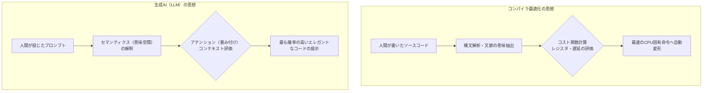

# 🧠 コンパイラ最適化と生成AI（LLM）の相似性検証
## 〜GCC（-O3）/ JVM（JIT）の実測値から読み解く、類推と最適化の設計思想〜

本ドキュメントは、ビットカウント・アルゴリズムの物理測定中に検知された「コンパイラによるコードの自動書き換え（最適化命令置換）」というエンジニアリング的現象を端緒に、計算機科学における「コンパイラ最適化」と「生成AI（LLM）による最適解提示」の根底に通底する共通の設計思想（エッセンス）を比較・考察した技術エッセイです。

---

## 📊 1. 検証の起点：物理ベンチマーク実測値の怪

同一CPU環境（VSCode+GCC / IntelliJ IDEA）における32ビット・ビットカウント処理の物理測定（秒）において、計算機の処理層（ハードウェアとソフトウェアの境界）で発生した「異常値」が本考察の起点となっています。

### 📋 物理処理時間 測定比較一覧（秒）

| アルゴリズム / 関数名 | C: 最適化なし | C: 最適化あり (`-O3`) | C: `volatile` 指定 | Java: デフォルト (JIT) | Java: 最適化なし (`-Xint`) |
| :--- | :---: | :---: | :---: | :---: | :---: |
| **① 力まかせループ** | 9.406 | 1.753 | - | 21.921 | 39.664 |
| **② 空間置換テーブル** | 0.682 | 0.092 | - | 8.705 | 17.035 |
| **③ カーニハン流** | 2.509 | **0.073** (急加速) | 0.921 (論理通り) | 13.924 | 22.551 |
| **④ HAKMEMの魔術** | 0.449 | 0.198 | - | **8.692** (最速) | 13.584 |
| **⑤ 並列加算（分割統治）**| 0.450 | 0.191 | - | 8.704 | 15.981 |
| **⑥ popcnt (CPU命令)** | 0.313 | 0.072 | - | 8.691 | 16.174 |

### 🛠️ 異常値から実証されるコンパイラ・VMの挙動
1. **C言語における静的最適化（GCC `-O3`）**:
   ③カーニハン流が **0.073秒** という、ハードウェア命令（popcnt）と同等の速度まで跳ね上がりました。これはコンパイラがループ構造の文脈を静的に解析し、内部的にCPUの物理命令（`popcnt`）へと自動変形（置換）していることを示しています（`volatile` 修飾子によって最適化変形を抑制すると、論理予測値通りの **0.921秒** に収束することからも裏付けられます）。
2. **Java環境における動的最適化（JVM JIT）**:
   デフォルト環境において、②、④、⑤、⑥が **ほぼ「8.6秒〜8.7秒」の同一ラインに美しく収束** しています。これも、JVMのJITコンパイラが動作中に実行コードのホットスポットを検知し、これら複数の異なるロジックを、裏側で一斉にCPUネイティブの固有命令（popcnt）へ最適化置換している強力な証拠です（`-Xint` オプションで最適化を剥がすと、論理通りの個別速度へとばらけます）。

---

## 🧠 2. 類推から最適解提示へ：二者に通底する共通の設計思想

一方は言語環境とハードウェアの規約に縛られた厳格な「決定論的システム」、もう一方は天文学的なパラメータの重み付けで動く「確率論的システム」ですが、その根底にある**「エンジニアリング的アプローチ」**には驚くほど美しい相似性（アナロジー）が存在します。

### ① 高次元の「セマンティクス（意味）」を捉えた構造置換
* **コンパイラ**: カーニハン流のループコード（③）の文字面をなぞるのではなく、「このロジックがやっている本質的な意図は、ビット列の1のカウントである」と**意味（イディオム）を解釈**し、低レイヤー層の最速命令へとダイナミックに構造をジャンプ（置換）させます。
* **AI（LLM）**: 人間が入力した「こういう処理がしたい」という曖昧な自然言語（高次元の意味空間）を解釈し、過去の膨大な学習データの中から、その意図に最も合致する最適なアルゴリズムへとマッピング（提示）します。

### ② コスト関数（確率・重み）による「もっともらしさ」の収束計算
* **コンパイラ**: コードを機械的に1対1翻訳するのではなく、レジスタの空き状況、メモリ複製のコスト、パイプラインの遅延（レイテンシ）を総合的に計算し、**「最も実行コストが低い（もっともらしい）命令系列」**へと最適化を収束させます。
* **AI（LLM）**: トークン（言葉やコードの断片）の繋がりにおける「アテンション（重み付け）」を多次元的に計算し、文脈の中で**「最も目的（仕様）に合致する（もっともらしい）コード」**へ向かって出力を収束させます。

### ③ 「定型パターン」への圧倒的な強さと、「未知の境界条件」での限界
* **コンパイラ**: 教科書的なループや定番のアルゴリズムに対しては完璧な最適化を施しますが、複雑にポインタが絡み合ったメモリ操作など、静的解析の「限界（境界条件）」を超えると、バグを避けるために一気に安全弁が働き、最適化を諦めて愚直なベタ処理（①）を出力します。
* **AI（LLM）**: ネット上に存在する既知の定型問題には完璧な最適解を返しますが、前提条件が複雑に入り組んだ例外（問107）に直面すると、手前の谷（ローカルミニマム）に囚われて不具合（疑似解）を吐き出します。

---

## 🌌 3. 結び：デジタルとアナログを繋ぐ「知性の物差し」

デジタルな計算機層を最適化する「コンパイラ」と、アナログな人間の思考層と協調する「AI」。
双方の技術の根底にある「意味の解読と最適化」の美しさを理解することは、これからのAI共創時代を生きるエンジニアにとって極めて重要な「知性の物差し」です。

中間コードのオーバーヘッドをロジックの軽さで叩き潰した「Java環境におけるHAKMEM（④）の最速化」が証明したように、環境の制約を理解した上での「人間の遊び心（別解の保持）」は、どれだけAIやコンパイラが進化しても決して色褪せないエンジニアリングの本質です。

技術の裏側にある共通の設計思想をインプットし、複数の視点から別解との一致を検証してシステムの信頼性へと引き上げること。この、**技術を楽しむ人間の品評眼**こそが、過渡期を軽やかにサバイバルしていくための最大の武器であると確信しています。

---
📄 **本検証の物理測定ログおよび、C/Javaの実行環境設定を含む原本Excelシートはこちらからダウンロードいただけます。**
* [ビットカウント各コードの詳細解説シート (.xlsx)](./supplementary-materials/ビットカウント.xlsx)

