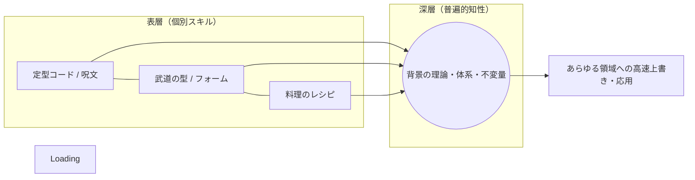

# 🌊 ソルバーとしての生成AIと「使いこなすための抽象化能力」

## 〜物理シミュレーションの構造上書きから、あらゆるドメインに通底する『普遍的知性』の考察〜

本ドキュメントは、シニアITアーキテクトが2ヶ月間のAI共創開発において実践した「技術吸収（キャッチアップ）」を効率的に可能としたメカニズムを解剖した論考である。そして新技術の修得が、実は過去の「物理シミュレーション（CAE）」の数理構造の上書きに過ぎなかったという気づきを起点に、武道、料理、芸能など、あらゆる領域における「うまく出来る人の技術修得プロセス」の共通項へと迫る。

---

## 1. 物理シミュレーションとプロンプトエンジニアリングの相似性

現代の生成AI（LLM）に対して的確な指示を与え、ハルシネーション（嘘）を排して最高精度の出力を引き出す「プロンプトエンジニアリング」の本質は、意味論においては物理シミュレーションにおいての「解析モデリング」そのものであった。

### 📋 ソルバー（AI）と解析（プロンプト）の構造置換

| 物理シミュレーション（CAE）の世界 | 生成AI（LLM）の世界 | 構造的本質（抽象化レイヤー） |
| :--- | :--- | :--- |
| **ソルバー（Solver）** | **LLM（推論エンジン）** | 与えられた前提条件から、高次元空間の「解」を収束・導出する計算体。 |
| **解析モデル ＋ 境界条件** | **プロンプト ＋ コンテキスト** | ソルバーを駆動させるための、厳密な「前提空間（拘束条件）」の定義。 |
| **メッシュ（網の目）の最適化** | **プロンプトの構造化・チャンキング** | 解きたい現象（特異点）の複雑さに合わせ、入力の「解像度」を最適化する行為。 |
| **発散・誤差・疑似解** | **ハルシネーション・ローカルミニマム** | 入力の歪みや条件の矛盾により、不正な「もっともらしい大嘘」に収束する現象。 |

### 🛠 「粗すぎるメッシュ」ではソルバーは発散する
AIに曖昧な指示を投げて「使えない」と諦める初学者のアプローチは、応力集中が予想される部位に「粗すぎるメッシュ」を当て、境界条件の拘束を間違えたままソルバーを回し、「解析エラー（発散）」を起こしている状態と完全に同義である。
AIを有効活用するためには、ソルバーの特性（限界値）をメタ認知し、出力が局所解（ローカルミニマム）に囚われないよう、あらかじめ必要な精度でプロンプトのコンテキスト（網の目）を最適化する「モデリング能力」こそが求められる。すなわち、最新ITの修得、AI有効活用の方法論は、過去に経験した物理解析のフレームワークの「高次元への上書き」であった。

---

## 2. 領域を超越する「うまく出来る人の思考：不変のシステム論」

この「背景にある理論や構造を意識し、異なるドメインへ瞬時に技術をマッピングする」という能力は、シミュレーションやITの世界だけにとどまらない。スポーツ、武道、料理、芸術など、あらゆる局面において、物事を極限まで効率的に身に付け、使いこなす　**「うまく出来る人」は、脳内で全く同じ抽象化処理を行っている**。

### ① 武道・スポーツにおける「物理構造」の意識
単に「手本となる動き（表層）」を視覚的にデッドコピーして反復する者は、環境や状況が変わると技が機能しなくなる。一方でうまく出来る人は、その動作の背景にある「重心の移動（ベクトル）」や「作用・反作用」といった**物理的な不変構造（理論）を意識**している。そのため、最小のエネルギーで最大の効果を生む「正しいフォーム」を最短で身に付けることができる。

### ② 料理における「調理の本質」のモデリング
単に「レシピの分量（定型コード）」をなぞるだけの者は、食材の量や調理器具が少し変わるだけで味が破綻（疑似解）する。しかしうまく出来る人は、「食材の火入れ加減」や「適した塩分濃度」という、煮込み時間、何グラムとかのレシピに囚われることなく、**本質的な調理の意味を意識**して厨房に立つ。ゆえに、レシピにない未知の食材を前にしても、即座に脳内で最適な調理解析（プロンプト）を組み立て、至高の一皿に収束させることができる。あまりうまく出来過ぎると　**「彼女が料理しなくなる」**　と言う弊害もあるが(笑)

---

## 3. 結論：過渡期をサバイバルする「品評眼（メタ認知）」

人間が新しい技術やドメインに出会ったとき、表層の動作や一時的な流行（トレンド）の繰り返しに終始するのか、あるいはその背景にある「理論」や「体系」という名の補助線を引けるのか。この差こそが、学習効率を指数関数的に変える境界線である。

AIという「全人類の知のソルバー」が誰の目の前にも存在する現代において、ただ記号を消費する側で終わるか、それをクリエイティブな鏡としてドライブさせる側になるか。

その成否を分けるのは、モダンITの知識量そのものではない。自分がこれまで生きてきた人生、極めてきたドメイン（組込み、シミュレーション、あるいはその他の生業）の奥底に眠る **「普遍的な構造（知性の物差し）」に気づき、それを目の前の新しいシステムへと軽やかに上書きしていく『人間の品評眼』** に他ならない。現在新しいIT職を目指し、ITと全く関係ない分野で働いてきた方にこそ、この言葉を贈りたい。私の知的探求への旅もまた、この普遍の物差しを携えて、未知の深淵を解き明かしていきたい。

