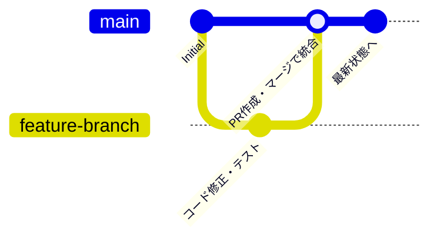

# GitHub Desktopを活用した安全な開発フロー（ブランチ運用編）

本ドキュメントでは、GitHub Desktopを使用して、既存のコードを壊さずに安全に機能追加やリファクタリング（例：JavaScriptからTypeScriptへの移行など）を進めるための基本サイクルを解説します。

---

## 1. 事前準備（クイックスタート）

### 1.1 リポジトリの準備
1. GitHub（Web）の画面右上「**＋**」から **New repository** を作成。
2. 任意の名前をつけ、公開範囲（Public/Private）を設定して作成。

### 1.2 GitHub Desktopの導入とクローン
1. [GitHub Desktop公式](https://github.com) からアプリをダウンロードし、インストール。
2. 自身のアカウントでログイン後、`File` -> `Clone repository...` から対象のリポジトリを選択。
3. ローカル（自身のPC）の任意のフォルダにプロジェクトをダウンロード（クローン）する。

---

## 2. 実践：安全なブランチ開発サイクル

本番用コード（`main` ブランチ）を保護するため、開発は必ず「切り離された実験場（フィーチャーブランチ）」で行います。

---
### Step 1：新しいブランチ（枝）を作る
1. GitHub Desktop上部の **Current Branch**（初期は `main`）をクリック。
2. **New Branch** をクリック。
3. タスクが分かりやすい名前（例: `migration-to-typescript` や `fix-audio-logic`）を入力して作成。
4. **Publish branch** を押して、このブランチをGitHub側にも共有する。

### Step 2：コードの修正とローカルへの記録（Commit）
1. VS Codeなどのエディタでクローンしたフォルダを開き、開発（TypeScript化や機能追加）を行う。
2. 動作テストを行い、区切りの良いところでGitHub Desktopに戻る。
3. 画面左側に変更されたファイルの一覧（Changes）と、差分（赤・緑の行）が表示されているのを確認。
4. 画面左下の **Summary（必須）** に変更内容（例: `型定義の追加とビルド環境の構築`）を日本語で入力。
5. **Commit to [ブランチ名]** をクリック（変更がPC内に記録される）。

### Step 3：GitHubへのバックアップ（Push）
1. コミット後、画面上部に表示される **Push origin** ボタンをクリック。
2. これにより、PC内の変更履歴がクラウド（GitHub）へアップロードされます。
   - *※作業の途中であっても、一日の終わりなどにこまめにPushしておくことで安全なバックアップになります。*

### Step 4：メインへの統合依頼（Pull Requestの作成）
開発が完了したら、実験場のコードを大元の `main` に合流させる依頼を出します。
1. GitHub Desktop右上の **Create Pull Request**（または Preview Pull Request）をクリック。
2. ブラウザでGitHubのページが自動的に開く。
3. 変更内容に問題がなければ、緑色の **Create pull request** ボタンをクリック。
   * *※個人開発においては、ここにエビデンス動画を貼り付けたり、数理的な解説をメモしたりすることで、強力な「開発ログ（Wiki）」として機能します。*

### Step 5：マージ（Merge）とローカルの同期
1. GitHubのウェブ画面上で、**Merge pull request** -> **Confirm merge** の順にクリック。これで `main` への統合が完了。
2. GitHub Desktopに戻り、**Current Branch** を `main` に切り替える。
3. 画面上部の **Pull origin**（またはFetch origin）をクリック。
4. これにより、GitHub上で合流した最新の `main` コードが手元のPCにも同期され、次の開発へ安全に進むことができます。

---

## 💡 知っておくと便利な Tips

- **迷宮入りしたらブランチごと捨てる**
  コードの書き換え（リファクタリング等）で行き詰まり、どこがバグの原因か分からなくなった場合は、そのブランチを削除して `main` から再度ブランチを切り直せば、一瞬で「確実に動いていた状態」から再スタートできます。
- **日本語の利用**
  GitHub DesktopのUI自体は英語ですが、コミットメッセージ（Summary）やコード内のコメント、Pull Requestの記述はすべて日本語で問題なく動作します。

---

## 📊 Git（GitHub）と SVN の比較表

| 比較項目 | Git (GitHub) （分散型） | SVN （中央集権型） |
| :--- | :--- | :--- |
| **リポジトリの持ち方** | **全員がすべての履歴**をローカルに持つ | **中央サーバーのみ**が履歴を持つ
| **ネットワーク依存** | コミットは**完全オフライン**で実行可能 |　コミットには**常にサーバー接続**が必要
| **ブランチの作成** | **一瞬**（ポインタを切り替えるだけ）  |　**遅い**（フォルダを丸ごとコピーする）
| **コンフリクトの解決** | マージ前に手元で安全に解決できる |　サーバーに送るまで衝突に気づきにくい
| **大容量ファイルの扱い** | **苦手**（全履歴を持つため肥大化しやすい） |　**得意**（必要な最新版だけを落とせる）

---

## 💡 SVNユーザーから見た Git / GitHub のメリット

### 1. ブランチ（枝分かれ）が圧倒的に軽くて速い
- SVN： ブランチを作る＝「サーバー側でディレクトリを丸ごと物理コピーする」ため、重くて大仕事でした。
- Git： 単なる「特定のコミットを指すポインタ」なので、1秒で作成・切り替えが完了します。だからこそ、気軽に使い捨てブランチが作れます。
### 2. 飛行機や新幹線の中でも「コミット」できる
- SVNはサーバーと通信できないと履歴を刻めませんでしたが、Gitは自分のPC（ローカル）が完全なリポジトリです。ネットが無くても、手元で何回でもコミット（履歴保存）が可能です。
### 3. メインのコード（main）を絶対に汚さない
- 手元で実験ブランチをいくら作ってコミットしても、GitHub（中央）には一切影響を与えません。「完成した」と確信してから初めて `Push` や `Pull Request` で統合するため、壊れたコードが共有されるリスクが激減します。
### 4. GitHubによる強力なエコシステム
- SVNの単なる「履歴保管庫」とは違い、GitHubにはIssue（タスク管理）、GitHub Pages（Web公開）、そしてAIとの共創環境が最初から高次元で統合されています。

---

## ⚠️ SVNユーザーが戸惑う Git / GitHub のデメリット（注意点）

### 1. 「リビジョン番号（r123）」という概念がない
- SVNでは「リビジョン100の次は101」と直感的でしたが、Gitは複数の人間が同時並行で履歴を作るため、`a1b2c3d...` のような **ハッシュ値（SHA-1）** でコミットを識別します。最初は「何番目の変更か」が直感的に分かりづらいです。
### 2. 覚えるステップが1つ多い
- SVNは `Commit` 一発でサーバーに保存されましたが、Gitは手元に記録する `Commit` と、それをクラウドに投げる `Push` の**2段階**の手間が必要です。
### 3. 巨大なバイナリファイルの管理には工夫が必要
- クローン時に「過去の全履歴」を丸ごとダウンロードする特性上、動画や重い3Dモデル、コンパイル後の巨大なバイナリ（`dist`や`.exe`など）をそのまま入れると、リポジトリがすぐに巨大化して動作が重くなります。（※`.gitignore` で除外するか、Git LFS という拡張機能を使う必要があります）
---
## 🎯 結論：どちらを選ぶべきか？

- SVNが向いているケース： 変更履歴を全員で1つに強制統一したい場合や、数ギガバイトある大型の3Dデータ・アセットを頻繁に更新するプロジェクト。
- Git/GitHubが向いているケース： TypeScriptのようなWeb開発、頻繁にリファクタリングを繰り返す開発、AIと協調しながら高速にプロトタイプを回す現代のモダン開発。

---
### ☕ 元組込み・SVNユーザーの視点から：なぜ今Gitなのか？

かつて組込み開発の現場でSVN（Subversion）を使っていた時代、ブランチ作成は管理者に依頼する一大イベントであり、コードのアップ順を開発者間でメール調整するような「人間系排他制御」が必須でした。一度コミットの巻き戻しに失敗すれば、チーム全体に影響が出る恐怖とも隣り合わせでした。

ツール（GitHub）の進化は、言語（TypeScript/Java）のコンポーネント化・オブジェクト指向化の歴史と密接に結びついている。C言語の密結合な世界では人間系の排他制御（SVN時代の工夫）が必要だったが、疎結合なモダン言語だからこそ、Gitの『分散型ブランチ運用』という強力な自動化プロセスの恩恵を最大限に享受できるのだ。

